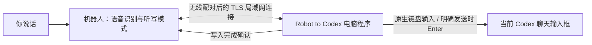

# Robot to Codex · 机器人语音输入 Codex


**把语音机器人的听写内容，输入到你当前选中的 Codex 聊天。** 先看屏幕核对草稿，单独说“发送”才提交；说“退出模式”后恢复机器人原来的聊天。

A Windows desktop companion that turns a compatible voice robot into a dictation input for the current Codex chat. Pair over your LAN, dictate into the draft, and explicitly say “发送” to submit. Includes a documented integration protocol for custom robots.

本仓库是电脑端软件与机器人接入规范，基于 [A3Boy/codex-voice-input](https://github.com/A3Boy/codex-voice-input) 改造。开发版本保持 **0.2.1**。

## 先确认：你的机器人能不能用

**安装电脑软件不会让任意机器人自动支持本功能。** 机器人固件需要实现 [CVI1 接口](docs/PROTOCOL.md)、无线安全配对和固定听写模式；仅仅是 ESP32-S3、能对话、带蓝牙或有 MCP 接入点，都不足以直接连接。

| 机器人情况 | 使用方式 |
| --- | --- |
| 已实现本文协议的机器人 | 打开程序，在机器人上开启配对，再输入六位码 |
| 本项目开发过程中改造的 ESP-SparkBot / 小智 v1.9.4 固件 | 已验证无线配对与输入；原始商家固件、官方同版本固件不等于这份改造固件 |
| 自己做的 ESP32、Linux 或其他语音机器人 | 参考 [接入指南](docs/ROBOT_INTEGRATION.md) 改造固件/机器人服务；目前没有这些设备的实机兼容承诺 |
| 无源码且没有所需接口的商用机器人 | 需要厂商开放接口或提供适配固件，不能只靠电脑端解决 |

**不限定 SparkBot 外形、主控品牌、麦克风或触摸按键。** 其他机器人可自己选择配对触发方式、显示方式和语音识别服务，只要实现相同的连接与交互规则。仓库不包含通用烧录包，也不包含原机全片备份。

## 能做什么

- 机器人与电脑通过同一局域网连接，第一次使用六位码无线配对，之后自动重连。
- 跟随当前 Codex 输入焦点；切换聊天后点击新的输入框即可，不绑定聊天 ID。
- 听写内容先进入草稿；单独说“发送”后按一次 Enter，发送后可以继续听写。
- 听写模式下，普通问句、设备功能名称、包含“退出模式”的长句都是正文。明确说退出口令才恢复聊天。
- 机器人在正文写入完成后反馈一次提示音，电脑端不播放提示音。
- 提供识别记录、复制、深浅外观、托盘和单实例运行。
- 断线或输入失败时暂停、作废旧队列，不自动补发或重复提交。

没有电脑麦克风/耳机录音、悬浮窗或全局快捷键；不读取 Codex 登录文件，不需要 OpenAI API Key，也不需要启动 MCP 管理器。

## 工作方式



电脑端接收的是**最终识别文字**，不是音频，也不负责调用识别模型。你可以在自己的机器人上使用不同的 ASR；小智参考设备仍使用小智在线识别服务。此仓库没有提供离线语音识别，亦没有替代机器人原有对话后台。

## 开始使用

需要 Windows 10 2004（19041）或更新版本 / Windows 11、x64、Codex 桌面应用，以及兼容机器人。电脑和机器人应位于可互通的局域网；电脑接网线也可以。

当前先提供源码。请按 [构建说明](docs/BUILD.md) 生成便携程序；不要把 GitHub 的源码 ZIP 当作安装包。本次源码公开不等于已经发布新的安装程序。

1. 构建后运行 `Start.cmd`，或运行 `dist/CodexVoiceInputRobot/CodexVoiceInput.exe`。便携目录需要完整保留。
2. 在机器人上通过实体操作开启配对，让它显示六位码。参考 SparkBot 是待机长触顶部约 3 秒；其他机器人由其固件定义。
3. 电脑点“添加机器人”，选中设备并输入六位码。码会直接显示，成功或取消后清空。
4. 配对成功后，等待“已连接”。换电脑时重新无线配对，无需把私钥或登录文件拷过去。
5. 在 Codex 选中聊天，**点击输入框**，然后按下面的方式口述。

| 你说的话 | 行为 |
| --- | --- |
| 开启语音输入 | 进入听写模式 |
| 帮我给这个函数增加日志 | 追加到当前输入框，等待机器人完成提示音 |
| 发送 | 提交已有听写草稿；没有新的听写内容时不重复发送 |
| 退出模式 | 恢复机器人聊天，保留未发送的草稿 |

口令目前是中文固定短语；部分旧开启/退出短语继续兼容，详见 [协议](docs/PROTOCOL.md)。程序不默认用大模型润色；只做基础文本清理。

连接被 Windows 防火墙拦截时，先按 [使用与排障](docs/USAGE.md) 检查。可手动以管理员运行 `scripts/configure-firewall.ps1`，它只为指定程序路径添加 LocalSubnet 范围的规则，不会自动运行，也不要求把端口开放到公网。

## 接入你自己的机器人

从 [机器人接入指南](docs/ROBOT_INTEGRATION.md) 开始，完整字段与消息顺序见 [CVI1 协议](docs/PROTOCOL.md)。

推荐复用已有 TLS 和 ESP-IDF Protocomm Security2 实现，不重新设计口令交换。新设备发送 `board: "cvi-robot"`，发现报文的 `name` 可以是自己的产品名称；旧 `esp-sparkbot` 标记继续兼容。12 位十六进制 `device` 是公开标识，不要求是真实 MAC，也不是登录凭证。

需要实现的关键能力：物理开启且限时的配对、最终 STT 事件、单调递增轮次、设备侧听写锁、输入前逐轮授权、完成确认、故障暂停和不重放。不能仅靠给聊天模型加一条提示词模拟这些规则。

## 源码结构

```text
src/VoiceInput.App/      WinUI 3 界面、Windows 输入与本地存储
src/VoiceInput.Robot/    CVI1、Security2 配对、TLS、轮次与队列
src/VoiceInput.Core/     基础文本处理
examples/               无键盘、无网络的适配示例
tests/                  自动化契约测试
scripts/                测试、启动、可选局域网防火墙配置
installer/              Inno Setup 安装配置，需自行构建
docs/                   使用、接入、协议、构建和安全说明
```

其中 `UsbRobotFeedback` 是沿用旧名称的共用协议引擎，桌面日常使用连接的是 Wi-Fi TLS，并不要求 USB。库中保留了 MCP/串口兼容实现与相关测试，当前桌面入口不启动它们；它们不是接入新机器人的推荐入口。

## 限制与隐私

- 当前面向一个 Windows 电脑程序与一个活动机器人连接，不是多机器人管理平台。
- 输入目标是前台 Codex 进程中的当前焦点。程序不读取聊天内容、不判断具体聊天 ID，也不能保证焦点一定在编辑框；口述前和切换聊天后请点输入框。提交方式是 Enter，需与你的 Codex 设置一致。
- 原生键盘输入成功表示输入事件已送出，不代表 Codex 服务端已经接收任务；以屏幕为准。不自动重试 Enter。
- 机器人、电脑程序和网络要保持可用；电脑关机或程序退出后无法输入。后台运行不等于云端托管。
- 小智参考固件仍依赖小智的识别与音频框架。迁移其他固件时要适配这些钩子，不是刷任意固件都能用。
- 配对凭证/电脑私钥通过 Windows 当前用户 DPAPI 加密；识别历史保存在本机，**历史文件是明文**。语音识别端的数据政策由你选的 ASR 服务决定。

详见 [SECURITY.md](SECURITY.md)。仓库不包含配对凭证、个人识别记录、Wi-Fi 密码、Codex 登录文件或任何私人备份。

## 开发与贡献

```powershell
# Windows PowerShell；先安装 .NET 8 SDK 并进入仓库
.\scripts\test.ps1
.\package.ps1
.\Start.cmd
```

更多说明见 [构建与验证](docs/BUILD.md)、[本次验证范围](docs/VALIDATION.md)、[贡献指南](CONTRIBUTING.md)。新设备欢迎提交适配说明与实机验证结果，请注明板型、固件、识别服务和已验证范围。

MIT，保留上游版权；第三方说明见 [THIRD_PARTY_NOTICES.md](THIRD_PARTY_NOTICES.md)。独立社区项目，与 OpenAI、Espressif 或机器人厂商不存在隶属或背书关系。
