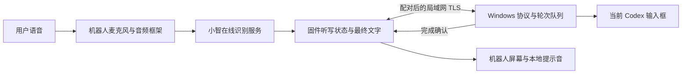

# 系统架构与源码导读

## 数据如何流动

语音识别与局域网文字输入是两段独立链路。Windows 程序接收最终文字，不接收音频，不负责识别。普通聊天保留小智原有后台；固定听写模式中的发送、退出和输入授权由代码管理。

## 三个边界

**识别与动作分开。** 模型/识别服务产生文字，固件和电脑程序根据明确规则处理。普通正文即使包含“发送”或“退出模式”，也不应触发对应动作。

**传输与输入分开。** TLS 连接成功只表示链路可用。电脑收到一轮文字后，还要核对设备授权、检查前台进程，再执行输入，随后反馈结果。

**输入完成与远端提交分开。** 程序发送 Windows 原生输入事件，不读取聊天内容或服务端任务状态。因此不把一次 Enter 认定为远端任务成功，也不自动重试 Enter。

## 源码入口

| 关注点 | 入口 |
| --- | --- |
| 最终识别文字、固定口令、授权与反馈 | [usb_voice_feedback.cc](../firmware/source/main/usb_voice_feedback.cc) |
| 固件听写状态机 | [voice_feedback_state.h](../firmware/source/main/voice_feedback_state.h) |
| TLS 与发现 | [wifi_voice_link.cc](../firmware/source/main/wifi_voice_link.cc) |
| Security2 配对 | [wifi_voice_pairing.cc](../firmware/source/main/wifi_voice_pairing.cc) |
| 工具执行入口与模式锁 | [mcp_server.cc](../firmware/source/main/mcp_server.cc) |
| 板级外设、触摸与底盘 | [esp_sparkbot_board.cc](../firmware/source/main/boards/esp-sparkbot/esp_sparkbot_board.cc) |
| 菜单/确认退出 | [spark_menu_state.h](../firmware/source/main/boards/esp-sparkbot/spark_menu_state.h) |
| 手势规则 | [spark_tilt_input.h](../firmware/source/main/boards/esp-sparkbot/spark_tilt_input.h) |
| Windows 文字会话 | [RobotTextSession.cs](../src/VoiceInput.Robot/RobotTextSession.cs) |
| Windows 输入队列 | [RobotSpeechDispatcher.cs](../src/VoiceInput.Robot/RobotSpeechDispatcher.cs) |
| Windows 无线与配对 | [WifiRobotServer.cs](../src/VoiceInput.Robot/WifiRobotServer.cs)、[WifiRobotPairing.cs](../src/VoiceInput.Robot/WifiRobotPairing.cs) |
| Windows 当前窗口输入 | [RobotCodexInput.cs](../src/VoiceInput.App/Services/RobotCodexInput.cs) |

`usb_voice_feedback` 是早期串口阶段沿用的名称；日常输入已经走配对 TLS。公开版协议详情见 [PROTOCOL.md](PROTOCOL.md)，其他设备适配见 [ROBOT_INTEGRATION.md](ROBOT_INTEGRATION.md)。

## 已配对连接与异常处理

- 首次配对由机器人本地电容触摸动作发起，临时码限时有效。
- 使用 ESP-IDF 官方 Protocomm Security2；日常连接走 TLS。
- Windows 凭证使用当前用户 DPAPI 保存；发布源码不包含运行凭证。
- 听写中故障进入暂停，作废旧队列，恢复后不补发旧句子。
- 本机固件含更新后的页面与触摸细节；公开电脑端仍为 0.1.0，参见 [版本与验证边界](SHOWCASE_VALIDATION.md)。
